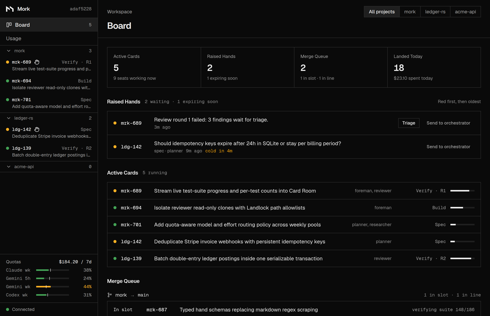
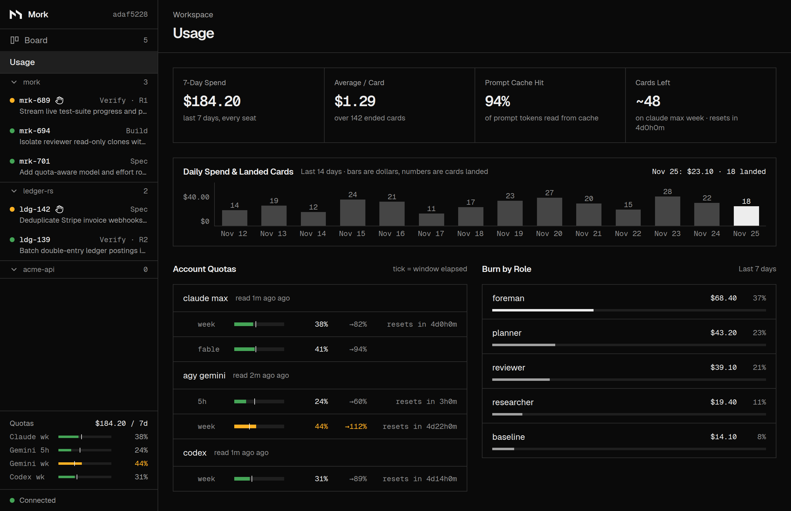

<p align="left">
  
</p>

# Mork

**Local Rust orchestrator for parallel Claude, Codex, and Gemini CLI workflows.**

Website: [https://mork.sh](https://mork.sh)

Mork drives the coding CLIs you already pay for (Claude Code, OpenAI Codex, Gemini) through a deterministic Rust state machine (~89k LOC Rust across 8 crates, ~5.5k LOC React/TypeScript). Each work card runs in its own git clone inside a Linux Bubblewrap + Landlock sandbox, gets audited by fresh read-only reviewers from a different model family with zero builder chat history, and lands through a serialized merge queue after checks and tests pass.



## What the engine enforces

Over 39 days of daily use (1,049 shipped work cards across four repositories: Mork itself, a large legacy Node/Angular production web app, a Rust game rewrite, and a web service), **45.8% of AI-written branches (330 of 720) failed independent review after local tests were green**, averaging 3.24 findings per failed branch (98.7% verified fixed before merge).

A single CLI session reviewing its own diff stays anchored on its own assumptions. Mork enforces the boundaries in code:

- **Sandboxed clones ("walls"):** Each card runs in its own git clone inside Linux Bubblewrap + Landlock (`crates/engine/src/jobs/wall.rs`, `wall_exec.rs`, `crates/sys/src/landlock.rs`). Reviewers inspect a clean read-only clone with no builder history.
- **Cross-family pairing:** Different model families plan, build, challenge plans, and review code, configured in `factory.toml`.
- **Proof-required findings:** Every review finding carries a `file:line`, failure path, and proof. Failed rounds route to structured triage (`Fix`, `Decline`, `Foreman decides`).
- **Raised Hands:** Seats stay quiet while working and interrupt you only when a product decision, visual mock approval, plan approval, or failed-round triage is needed.
- **Serialized merge queue:** Approved branches run checks, review rounds, and full test suites side by side, then land serially onto base so parallel cards do not trample each other.
- **Local web dashboard:** React + TypeScript UI served over a keyed localhost bridge (`crates/engine/src/web/`, `web/`), with a full-width Board, 50/50 Card Room, live test-suite progress, and Usage / Quota pace tracking.




## Architecture

Mork is an 8-crate Rust workspace with a dependency graph and boundary rules enforced by `cargo xtask check` (`crates/xtask/src/graph.rs`):

| Path | Role |
| --- | --- |
| `crates/types/` | Wire protocol, view models, config schema, and domain identifiers (`CardId`, `AskId`, `JobId`). |
| `crates/core/` | Pure deterministic state machine: card lifecycle, review rounds, triage, merge queue, SQL/file door rules, and view builders (zero I/O). |
| `crates/engine/` | Runtime loop, SQLite event journal (`store/`), Bubblewrap + Landlock sandboxing (`jobs/wall.rs`, `jobs/wall_exec.rs`), CLI drivers (`cli/`), live test-suite watcher, Vite visual mock host, and keyed localhost web bridge (`web/`). |
| `crates/sys/` | Isolated OS primitives (Landlock syscall bindings and process/sandbox helpers; the only crate permitted to use `unsafe`). |
| `crates/ui/` | Native Linux desktop window crate. |
| `crates/app/` | Main binary (`factory`), CLI control client (`factory ctl`), and embedded roles/manuals/skills. |
| `crates/fakes/` | Fake CLI/Bitbucket harnesses used by integration tests. |
| `crates/xtask/` | Workspace verification: rustfmt, comments, clippy, crate-graph and capability audits, file/function size caps, web Tailwind/TS checks, and parallel test runner. |
| `web/` | Local web UI (React 19, TypeScript, Tailwind CSS v4, Vite). |
| `manuals/`, `roles/`, `skills/` | Operating manuals and on-demand skills loaded into agent seats. |

> **Transition note:** Mork started as a personal tool named `factory`. Crate names, the binary (`factory`), `~/.config/factory/factory.toml`, and some operator strings still carry that history while the full `factory` -> `mork` rename is underway.

## Security Model and Current Limitations

- **Filesystem vs. network isolation:** File isolation is enforced by Bubblewrap mounts (`--ro-bind / /`, tmpfs over host home directories, read-write only inside the card's clone and scratch paths) with `--unshare-user/pid/ipc` and `--cap-drop ALL`. The network namespace is not unshared because CLIs need HTTPS access to model APIs; Landlock restricts outbound TCP connect ports (default `443`, `80`, `53` in `crates/types/src/config.rs`) and does not add Landlock filesystem rules.
- **Shared agent home:** Seats share one `~/.local/share/factory/agent-home` directory for CLI credentials and session state. Per-seat home isolation is not yet implemented.
- **Autonomous CLI execution:** Inside the sandbox, seats run with CLI permission prompts disabled so work does not stall waiting on interactive shell prompts. The sandbox wall and door allowlists are the enforcement boundary.
- **PR automation:** Local git merge-queue landings work with any git repository. Hosted pull-request review/merge automation currently targets Bitbucket only (GitHub PR automation is not implemented yet).
- **Self-build project setting:** `[factory] project` in `factory.toml` identifies Mork's own repository for self-rebuilds and an extra unwalled verification run on Mork's own test suite. Leave it set to `"mork"` (not your app's `[projects.<name>]`) unless you are developing Mork itself; making this field optional is planned alongside the `mork` rename.

## Quick Start (Linux)

### Prerequisites

- **Linux** with user namespaces enabled, `bwrap` (Bubblewrap), and Landlock ABI 6+
- **Rust** toolchain (`cargo`, `rustc`)
- **Node.js 22+** (for building `web/`)
- One or more supported agent CLIs installed and signed in (`claude`, `codex`, etc.)

### Build and Run

```bash
# 1. Clone the repository
git clone https://github.com/AndreiIlie/mork.git
cd mork

# 2. Build the web UI
cargo xtask web

# 3. Copy and edit the example config
mkdir -p ~/.config/factory
cp factory.example.toml ~/.config/factory/factory.toml
# Edit ~/.config/factory/factory.toml with your repo, board, and toolchain paths

# 4. Build and run the engine
cargo build --release -p factory-app
./target/release/factory
```

Open the keyed localhost URL printed by `./target/release/factory web` to access the web UI, or control cards directly from the CLI:

```bash
factory ctl card.create my-app "Short title" "Problem statement and evidence"
factory ctl start <card-id>
factory status
```

## Development Checks

```bash
cargo xtask web        # Tailwind class audit, TypeScript typecheck, and Vite production build
cargo xtask check      # rustfmt, comments, clippy, crate graph, size caps, and web checks
cargo xtask test       # Parallel workspace test runner (set FACTORY_UNWALLED=1 inside containers without bwrap)
```

## License

[MIT](LICENSE)
