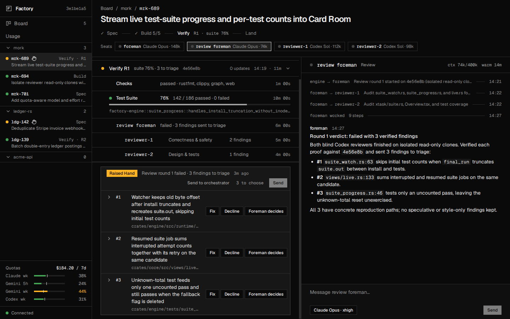

<p align="left">
  
</p>

# Mork

[](https://github.com/AndreiIlie/mork/actions/workflows/ci.yml)
[](LICENSE)

**Local Rust orchestrator for parallel Claude, Codex, and Gemini CLI workflows.**

Website: [https://mork.sh](https://mork.sh) · [Architecture](ARCHITECTURE.md) · [Security Model](SECURITY.md)

Mork drives the coding CLIs you already pay for (Claude Code, OpenAI Codex, Gemini) through a deterministic Rust state machine (~95k LOC Rust across 8 crates, ~5.5k LOC React/TypeScript). Each work card runs in its own git clone inside a Linux Bubblewrap + Landlock + seccomp-bpf sandbox with an isolated per-seat home directory, gets audited by fresh read-only reviewers from a different model family with zero builder chat history, and lands through a serialized merge queue after checks and tests pass.


## What the engine enforces

Over 39 days of daily use (1,049 shipped work cards across four repositories: Mork itself, a large legacy Node/Angular production web app, a Rust game rewrite, and a web service), **45.8% of AI-written branches (330 of 720) failed independent review after local tests were green**, averaging 3.24 findings per failed branch (98.7% verified fixed before merge).

A single CLI session reviewing its own diff stays anchored on its own assumptions. Mork enforces the boundaries in code:

- **Sandboxed clones ("walls"):** Each card runs in its own git clone inside Linux Bubblewrap + Landlock + seccomp-bpf (`crates/engine/src/jobs/wall.rs`, `wall_exec.rs`, `crates/sys/src/{landlock,seccomp}.rs`). Every seat gets its own private writable home directory (`crates/engine/src/seat_homes.rs`), and reviewers inspect a clean read-only clone with no builder history.
- **Cross-family pairing:** Different model families plan, build, challenge plans, and review code, configured in `mork.toml`.
- **Proof-required findings & deliberation:** Every review finding carries a `file:line`, failure path, and proof. Disputed findings run one bounded deliberation turn before being dropped, and failed rounds route to structured triage (`Fix`, `Decline`, `Foreman decides`).
- **Raised Hands:** Seats stay quiet while working and interrupt you only when a product decision, visual direction/mock approval, plan approval, or failed-round triage is needed.
- **Serialized merge queue & early checks:** Candidate diffs are scanned for secrets and modified/deleted test assertions before verification, then approved branches run checks, review rounds, and full test suites side by side before landing serially onto base.
- **Local web dashboard & CLI search:** React + TypeScript UI served over a keyed localhost bridge (`crates/engine/src/web/`, `web/`), with Board, Card Room, live test-suite progress, per-`(cli, model)` prompt-cache tracking, and instant command discovery via `mork ctl search <query>`.




## Architecture

Mork is an 8-crate Rust workspace with a dependency graph and boundary rules enforced by `cargo xtask check` (`crates/xtask/src/graph.rs`):

| Path | Role |
| --- | --- |
| `crates/types/` | Wire protocol, view models, modular provider config schema (`board`, `forge`, `tickets`), and domain identifiers (`CardId`, `AskId`, `JobId`). |
| `crates/core/` | Pure deterministic state machine: card lifecycle, review rounds, triage, merge queue, SQL/file door rules, and view builders (zero I/O). |
| `crates/engine/` | Runtime loop, SQLite event journal (`store/`), Bubblewrap + Landlock + seccomp-bpf sandboxing (`jobs/`), per-seat homes (`seat_homes.rs`), modular `board`/`forge`/`tickets` traits, CLI drivers (`cli/`), live test-suite watcher, Vite visual mock host, and keyed localhost web bridge (`web/`). |
| `crates/sys/` | Isolated OS primitives (Landlock and seccomp-bpf syscall bindings and `openat`-rooted symlink-safe file helpers; the only crate permitted to use `unsafe`). |
| `crates/ui/` | Native Linux desktop window crate. |
| `crates/app/` | Main binary (`mork`), CLI control client (`mork ctl`, `mork ctl search`), and embedded roles/manuals/skills. |
| `crates/fakes/` | Fake CLI/forge harnesses used by integration tests. |
| `crates/xtask/` | Workspace verification: rustfmt, comments, clippy, crate-graph and capability audits, file/function size caps, test-assertion diff checks, web Tailwind/TS checks, and parallel test runner. |
| `web/` | Local web UI (React 19, TypeScript, Tailwind CSS v4, Vite). |
| `manuals/`, `roles/`, `skills/` | Operating manuals and on-demand skills loaded into agent seats. |

## Security Model and Current Limitations

- **Filesystem, syscall, and per-seat isolation:** File isolation is enforced by Bubblewrap mounts (`--ro-bind / /`, tmpfs over host home directories, read-write only inside the card's clone and scratch paths) with `--unshare-user/pid/ipc`, `--cap-drop ALL`, a minimal seccomp-bpf filter denying x32 ABI, `io_uring_setup`, `userfaultfd`, and `ptrace`, and private per-seat home directories (`homes/`).
- **Network egress:** Walled agent turns run with `--unshare-net` and private loopback. Configure `domains` for the model APIs and registries your seats use. A host-side CONNECT proxy checks the requested host and port before DNS. Project `host_ports` and card preview and mock ports are bridged, excluding the web bridge and SSH tunnels.
- **Autonomous CLI execution:** Inside the sandbox, seats run with CLI permission prompts disabled so work does not stall waiting on interactive shell prompts. The sandbox wall, fail-closed `PreToolUse` hooks, and door allowlists are the enforcement boundary.
- **Hosted forge support:** Local git merge-queue landings work with any git repository. Hosted PR automation currently implements Bitbucket behind the `ForgeRead`/`ForgeWrite` traits; a GitHub Issues + Pull Requests provider is next on the roadmap.

## Quick Start (Linux)

### Prerequisites

- **Linux** with user namespaces enabled, `bwrap` (Bubblewrap), and Landlock ABI 6+
- **Rust** toolchain (`cargo`, `rustc`)
- **Node.js 22+** (for building `web/`)
- One or more supported agent CLIs installed and signed in (`claude`, `codex`, etc.)

### Build and Run

```bash
# 1. Clone the repository
git clone https://github.com/AndreiIlie/mork.git
cd mork

# 2. Build the web UI
cargo xtask web

# 3. Copy and edit the example config
mkdir -p ~/.config/mork
cp mork.example.toml ~/.config/mork/mork.toml
# Edit ~/.config/mork/mork.toml with your repo, board, and toolchain paths

# 4. Build and run the engine
cargo build --release -p mork-app
./target/release/mork
```

Open the keyed localhost URL printed by `./target/release/mork web` to access the web UI, or control cards directly from the CLI:

```bash
mork ctl card.create my-app "Short title" "Problem statement and evidence"
mork ctl start <card-id>
mork ctl search <query>
mork status
```

## Development Checks

```bash
cargo xtask web        # Tailwind class audit, TypeScript typecheck, and Vite production build
cargo xtask check      # rustfmt, comments, clippy, crate graph, size caps, and web checks
cargo xtask test       # Parallel workspace test runner (set MORK_UNWALLED=1 inside containers without bwrap)
```

## License

[MIT](LICENSE)
